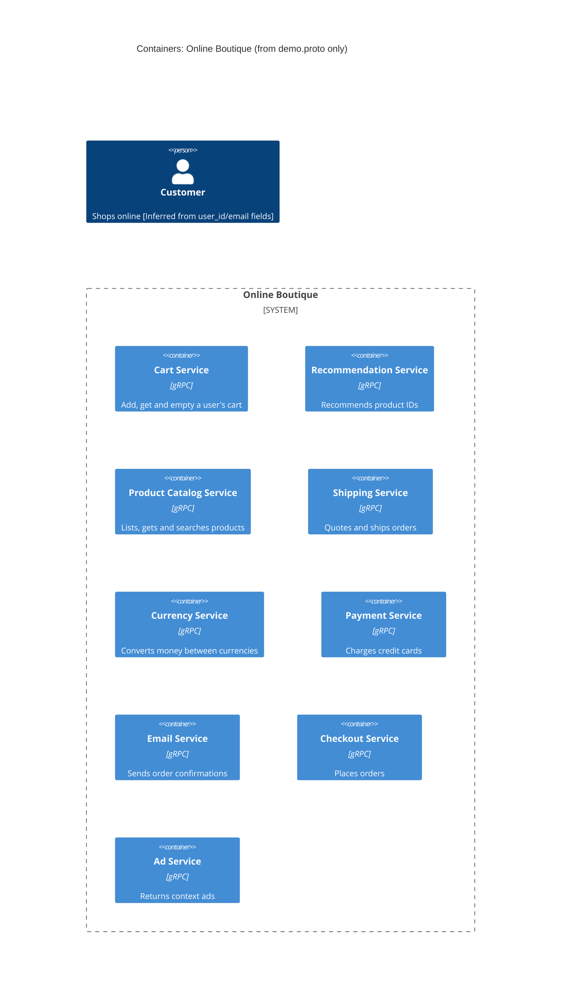

# 1A: Recovered architecture (evidence: interfaces only)

## 1. Agent

Claude Code (VS Code extension), model Claude Opus 5.5 (`claude-opus-5-5`).

## 2. Files read

- `prompts/1-recover-architecture.md` (task file)
- `system/online-boutique/protos/demo.proto` (the only evidence)

## 3. Containers table

The proto file defines gRPC service interfaces (`package hipstershop`). Each `service` is listed as a container. The proto does not say which language implements a service, so that column only gives the interface technology.

| Container | Technology / language | Responsibility | Evidence |
|---|---|---|---|
| Cart Service | gRPC (implementation language not evidenced) | Add items, get and empty a user's cart (`AddItem`, `GetCart`, `EmptyCart`) | `system/online-boutique/protos/demo.proto` (`service CartService`, l.23) |
| Recommendation Service | gRPC (language not evidenced) | Return recommended product IDs for a user and product list (`ListRecommendations`) | `demo.proto` (`service RecommendationService`, l.56) |
| Product Catalog Service | gRPC (language not evidenced) | List, get and search products (`ListProducts`, `GetProduct`, `SearchProducts`) | `demo.proto` (`service ProductCatalogService`, l.71) |
| Shipping Service | gRPC (language not evidenced) | Quote shipping cost and ship an order, returning a tracking ID (`GetQuote`, `ShipOrder`) | `demo.proto` (`service ShippingService`, l.107) |
| Currency Service | gRPC (language not evidenced) | List supported currencies and convert `Money` (`GetSupportedCurrencies`, `Convert`) | `demo.proto` (`service CurrencyService`, l.140) |
| Payment Service | gRPC (language not evidenced) | Charge a credit card, returning a transaction ID (`Charge`) | `demo.proto` (`service PaymentService`, l.177) |
| Email Service | gRPC (language not evidenced) | Send an order confirmation email (`SendOrderConfirmation`) | `demo.proto` (`service EmailService`, l.199) |
| Checkout Service | gRPC (language not evidenced) | Place an order and return an `OrderResult` (`PlaceOrder`) | `demo.proto` (`service CheckoutService`, l.224) |
| Ad Service | gRPC (language not evidenced) | Return text ads for page context keywords (`GetAds`) | `demo.proto` (`service AdService`, l.243) |

No data stores, message brokers or UI/frontend container are evidenced in this file.

## 4. Dependencies table

A `.proto` file declares what each service *offers*. It does not declare who *calls* it. So **no runtime dependency between containers is evidenced**.

| Caller → callee | Protocol | Evidence |
|---|---|---|
| *(none evidenced)* | | `demo.proto` defines servers only; no client/caller information |

## 5. Mermaid diagram

The diagram has no `Rel` lines because the dependencies table is empty. The `Person` is shown because the interfaces carry a `user_id` and an `email` (`PlaceOrderRequest`, l.228–235), which implies an end user. How that user reaches the system is not evidenced. **[Inferred]**

## 6. Gaps

| Gap | Why the proto can't settle it | File that would settle it |
|---|---|---|
| Who calls whom (all dependencies) | Proto defines servers, not clients | `kubernetes-manifests/*.yaml` (`*_SERVICE_ADDR` env vars) or each service's source, e.g. `src/checkoutservice/main.go` |
| A frontend / web UI container | No `FrontendService` in the proto; a browser UI would speak HTTP, not gRPC | `kubernetes-manifests/frontend.yaml`, `src/frontend/` |
| Data store for carts | `CartService` keeps per-user state, but no store is named | `kubernetes-manifests/cartservice.yaml` and any Redis/DB manifest |
| Implementation language of each service | Proto is language-neutral (only `go_package` option, l.19, which is for generated code) | Each service's `Dockerfile` or `src/<service>/` |
| External systems (real payment provider, email provider, currency rate source) | Not named in the interfaces | `src/paymentservice/`, `src/emailservice/`, `src/currencyservice/` |
| Load generator or other clients | Not visible in interfaces | `kubernetes-manifests/` |
| **[Inferred], not shown:** `CheckoutService.PlaceOrder` probably orchestrates Cart, Product Catalog, Currency, Shipping, Payment and Email, because `PlaceOrderRequest`/`OrderResult` contain what those services take or return (address, credit card, email, tracking ID, shipping cost) | Matching message types is a hint, not evidence of a call | `src/checkoutservice/main.go` or `kubernetes-manifests/checkoutservice.yaml` |
