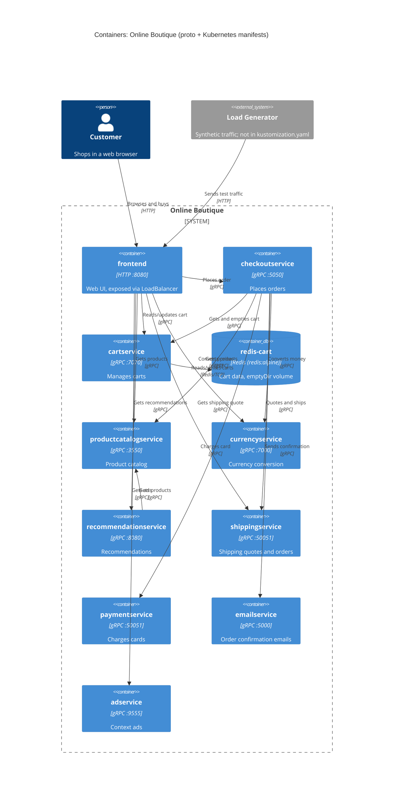

# 1B: Recovered architecture (evidence: interfaces + deployment config)

## 1. Agent

Claude Code (VS Code extension), model Claude Opus 5.5 (`claude-opus-5-5`).

## 2. Files read

- `prompts/1-recover-architecture.md` (task file)
- `system/online-boutique/protos/demo.proto`
- `system/online-boutique/kubernetes-manifests/README.md`
- `system/online-boutique/kubernetes-manifests/kustomization.yaml`
- `system/online-boutique/kubernetes-manifests/adservice.yaml`
- `system/online-boutique/kubernetes-manifests/cartservice.yaml`
- `system/online-boutique/kubernetes-manifests/checkoutservice.yaml`
- `system/online-boutique/kubernetes-manifests/currencyservice.yaml`
- `system/online-boutique/kubernetes-manifests/emailservice.yaml`
- `system/online-boutique/kubernetes-manifests/frontend.yaml`
- `system/online-boutique/kubernetes-manifests/loadgenerator.yaml`
- `system/online-boutique/kubernetes-manifests/paymentservice.yaml`
- `system/online-boutique/kubernetes-manifests/productcatalogservice.yaml`
- `system/online-boutique/kubernetes-manifests/recommendationservice.yaml`
- `system/online-boutique/kubernetes-manifests/shippingservice.yaml`

(Paths below are relative to `system/online-boutique/`. `k8s/` = `kubernetes-manifests/`.)

## 3. Containers table

Implementation languages are **not evidenced**: every `image:` is a bare name such as `image: cartservice` (the folder's `README.md` says Skaffold fills in the tags). The only concrete image is `redis:alpine`.

| Container | Technology / language | Responsibility | Evidence |
|---|---|---|---|
| frontend | HTTP server, port 8080 (language not evidenced) | Web UI; the only service exposed outside the cluster | `k8s/frontend.yaml` (Service `frontend-external`, `type: LoadBalancer`, port 80→8080; `httpGet /_healthz`) |
| cartservice | gRPC :7070 | Stores and returns user carts | `k8s/cartservice.yaml` (Deployment `cartservice`); `protos/demo.proto` (`service CartService`) |
| redis-cart | Redis (`redis:alpine`) :6379 | Cart data store | `k8s/cartservice.yaml` (Deployment `redis-cart`, `image: redis:alpine`, volume `redis-data: emptyDir`) |
| productcatalogservice | gRPC :3550 | Lists, gets and searches products | `k8s/productcatalogservice.yaml`; `demo.proto` (`service ProductCatalogService`) |
| currencyservice | gRPC :7000 | Currency list and conversion | `k8s/currencyservice.yaml`; `demo.proto` (`service CurrencyService`) |
| recommendationservice | gRPC :8080 | Recommends products | `k8s/recommendationservice.yaml`; `demo.proto` (`service RecommendationService`) |
| shippingservice | gRPC :50051 | Shipping quotes and shipping orders | `k8s/shippingservice.yaml`; `demo.proto` (`service ShippingService`) |
| checkoutservice | gRPC :5050 | Places orders | `k8s/checkoutservice.yaml`; `demo.proto` (`service CheckoutService`) |
| paymentservice | gRPC :50051 | Charges credit cards | `k8s/paymentservice.yaml`; `demo.proto` (`service PaymentService`) |
| emailservice | gRPC, Service port 5000 → container 8080 | Sends order confirmation emails | `k8s/emailservice.yaml` (Service port 5000, `targetPort: 8080`); `demo.proto` (`service EmailService`) |
| adservice | gRPC :9555 | Returns context ads | `k8s/adservice.yaml`; `demo.proto` (`service AdService`) |
| loadgenerator *(shown as external)* | HTTP client (language not evidenced) | Generates synthetic traffic (`USERS=10`, `RATE=1`) | `k8s/loadgenerator.yaml`. **Not** listed in `k8s/kustomization.yaml` `resources`, so it is not part of the default deployment |

gRPC protocol evidence for the services: each Kubernetes Service names its port `grpc`, and the probes use `grpc:` health checks (e.g. `k8s/checkoutservice.yaml`, `ports: - name: grpc`).

## 4. Dependencies table

| Caller → callee | Protocol | Evidence |
|---|---|---|
| Customer → frontend | HTTP | `k8s/frontend.yaml` (Service `frontend-external`, `LoadBalancer`, port `http` 80) |
| loadgenerator → frontend | HTTP | `k8s/loadgenerator.yaml` (`FRONTEND_ADDR=frontend:80`; init container `wget http://${FRONTEND_ADDR}`) |
| frontend → productcatalogservice | gRPC | `k8s/frontend.yaml` (`PRODUCT_CATALOG_SERVICE_ADDR=productcatalogservice:3550`) |
| frontend → currencyservice | gRPC | `k8s/frontend.yaml` (`CURRENCY_SERVICE_ADDR=currencyservice:7000`) |
| frontend → cartservice | gRPC | `k8s/frontend.yaml` (`CART_SERVICE_ADDR=cartservice:7070`) |
| frontend → recommendationservice | gRPC | `k8s/frontend.yaml` (`RECOMMENDATION_SERVICE_ADDR=recommendationservice:8080`) |
| frontend → shippingservice | gRPC | `k8s/frontend.yaml` (`SHIPPING_SERVICE_ADDR=shippingservice:50051`) |
| frontend → checkoutservice | gRPC | `k8s/frontend.yaml` (`CHECKOUT_SERVICE_ADDR=checkoutservice:5050`) |
| frontend → adservice | gRPC | `k8s/frontend.yaml` (`AD_SERVICE_ADDR=adservice:9555`) |
| checkoutservice → productcatalogservice | gRPC | `k8s/checkoutservice.yaml` (`PRODUCT_CATALOG_SERVICE_ADDR`) |
| checkoutservice → shippingservice | gRPC | `k8s/checkoutservice.yaml` (`SHIPPING_SERVICE_ADDR`) |
| checkoutservice → paymentservice | gRPC | `k8s/checkoutservice.yaml` (`PAYMENT_SERVICE_ADDR=paymentservice:50051`) |
| checkoutservice → emailservice | gRPC | `k8s/checkoutservice.yaml` (`EMAIL_SERVICE_ADDR=emailservice:5000`) |
| checkoutservice → currencyservice | gRPC | `k8s/checkoutservice.yaml` (`CURRENCY_SERVICE_ADDR`) |
| checkoutservice → cartservice | gRPC | `k8s/checkoutservice.yaml` (`CART_SERVICE_ADDR`) |
| recommendationservice → productcatalogservice | gRPC | `k8s/recommendationservice.yaml` (`PRODUCT_CATALOG_SERVICE_ADDR`) |
| cartservice → redis-cart | Redis protocol (TCP) | `k8s/cartservice.yaml` (`REDIS_ADDR=redis-cart:6379`; Service port name `tcp-redis`) |

Caveat: an `*_ADDR` environment variable shows that a service is *configured* with an address. That it actually calls it at runtime is very likely but would be confirmed by the source code. **[Inferred]**

## 5. Mermaid diagram

## 6. Gaps

| Gap | What the evidence shows | File that would settle it |
|---|---|---|
| **`shoppingassistantservice`** | `k8s/frontend.yaml` sets `SHOPPING_ASSISTANT_SERVICE_ADDR=shoppingassistantservice:80`, but there is **no manifest** for it and `ENABLE_ASSISTANT` is commented out. Left out of the diagram: an address without a deployment doesn't prove the service exists | `src/frontend/` (how the address is used); a `shoppingassistantservice` manifest |
| Packaging service | Only in a commented-out `PACKAGING_SERVICE_URL` in `k8s/frontend.yaml` ("optional Google Cloud demo"). Left out | `src/frontend/` |
| Implementation language of each service | Images are bare names | `src/<service>/Dockerfile` or source |
| Do currency, shipping, payment, email and ad services call anything? | No `*_ADDR` variables in their manifests; but a hard-coded or external call wouldn't appear here | `src/<service>/` source |
| Real external providers (payment gateway, email/SMTP, currency rates) | None configured; `paymentservice` and `emailservice` have no external address variables | `src/paymentservice/`, `src/emailservice/`, `src/currencyservice/` |
| Product catalog data store | No DB or volume in `k8s/productcatalogservice.yaml`; data may be bundled in the image **[Inferred]** | `src/productcatalogservice/` |
| Cart durability | `redis-cart` uses `emptyDir`, so carts are lost when the pod is rescheduled; no replicas set | Matches `k8s/cartservice.yaml`; intent would be in an ADR |
| Whether `*_ADDR` variables are really called at runtime | Config only | e.g. `src/checkoutservice/main.go`, `src/frontend/` |
| Profiler / observability backend | `DISABLE_PROFILER` / `ENABLE_PROFILER` variables hint at an external profiler, but none is configured | Service source code |
| loadgenerator in production? | Present in the folder but not in `kustomization.yaml` | Deployment scripts / Skaffold config |
